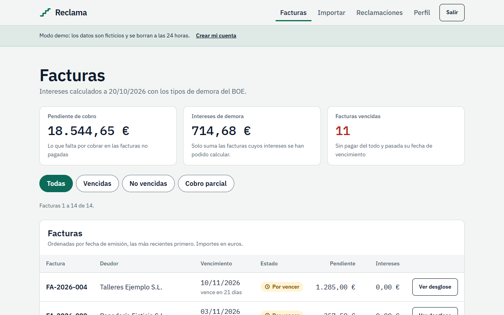
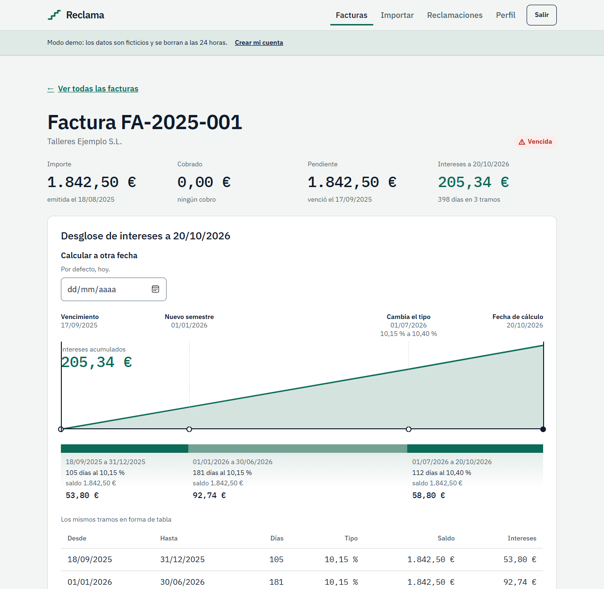
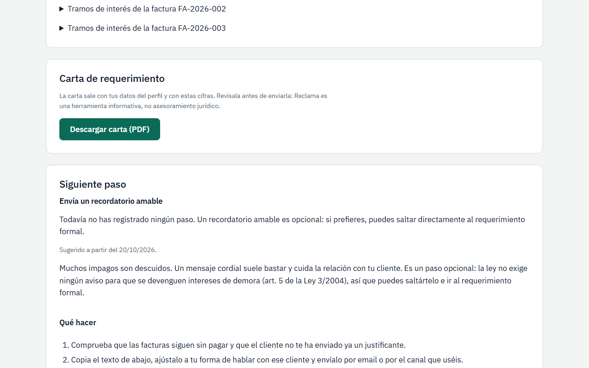
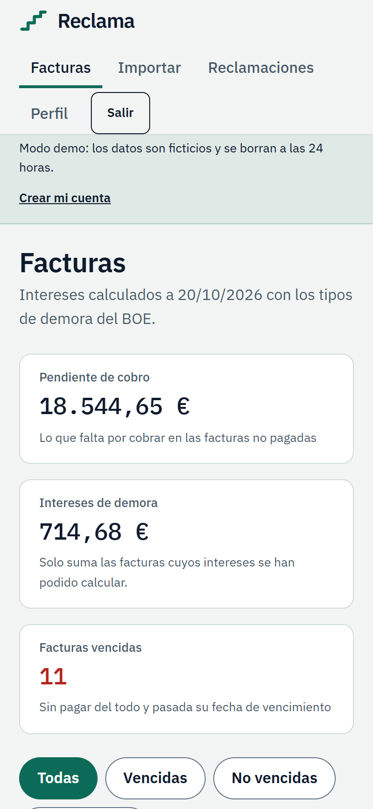
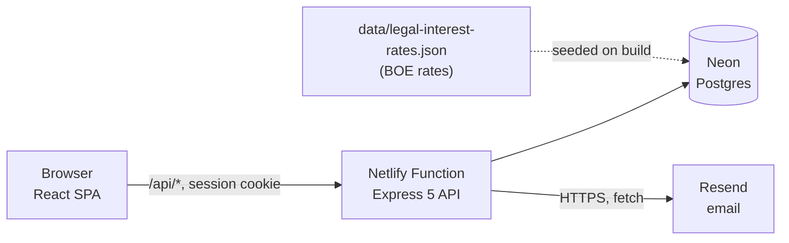

# Reclama

Late payment assistant for Spanish freelancers and small businesses.

[](https://github.com/jmartintechit-blip/Reclama/actions/workflows/ci.yml)
[](LICENSE)
[](https://main--reclama-app.netlify.app/demo)

Reclama computes the default interest an unpaid B2B invoice has earned under Spanish law (Ley 3/2004), builds a formal payment-demand letter as a PDF, and walks you through the next step: reminder, formal demand, burofax, monitorio procedure. The 40 EUR collection-cost compensation is included and configurable.



**[Try the demo](https://main--reclama-app.netlify.app/demo)**. No signup: it creates a fictitious sandbox. The session lasts 2 hours and the data expires after 24 (it is purged when the next sandbox is created). The interface is in Spanish.

> Reclama is an informational tool, not legal advice. See [Known limitations](#known-limitations).

## Why this exists

Late payment is common among small suppliers. Spanish law already gives you default interest and a fixed compensation of 40 EUR (whether it applies per invoice or per claim is debated, so Reclama lets you choose), and the interest runs without any reminder. Most freelancers still do not claim it. The work is tedious: look up the rate for each semester, count the days, split the invoice into segments, write the letter, and decide what to do when nobody answers.

Reclama does that arithmetic and paperwork and shows every step of the calculation.

## What it does

- Imports invoices from a Spanish-style CSV (up to 1 MB and 500 rows, with a dry-run preview), or adds them by hand.
- Calculates default interest per invoice: one segment per semester, partial payments, a custom agreed rate, an estimated due date when none is given.
- Shows the breakdown as a table and a curve, for today or for any other date.
- Builds a claim for one debtor and freezes its figures. Compensation of 40 EUR can be added per claim, per invoice, or not at all.
- Generates the demand letter as a PDF, using your profile data and the frozen figures.
- Suggests the next escalation step and keeps a log of the steps you took.
- Sends the demand by email through Resend (sandbox only, see limitations).

| Invoice breakdown                                                      | Claim and next step                                                  | Mobile                                                    |
| ---------------------------------------------------------------------- | -------------------------------------------------------------------- | --------------------------------------------------------- |
|  |  |  |
| Three semester segments and the accumulated interest curve.            | The letter download and the suggested next step.                     | The same dashboard at 390 px wide.                        |

All names, amounts and screenshots are fictitious.

## How the interest is calculated

Simple interest, one segment per semester, counted from the day after the due date until the calculation date. Each segment is:

```text
interest = balance x rate x days / days in the year
```

Each segment is rounded half-up to the cent, and the total is the sum of the rounded segments. The days in the year are 365 or 366 (actual/actual).

**Worked example.** A fictitious invoice of 8,940.00 EUR, due 2025-09-12, calculated as of 2026-10-19. This is also the example on the home page.

| Segment                       | Days | Rate   |     Interest |
| ----------------------------- | ---: | ------ | -----------: |
| 2025-09-13 - 2025-12-31       |  110 | 10.15% |       273.47 |
| 2026-01-01 - 2026-06-30       |  181 | 10.15% |       449.98 |
| 2026-07-01 - 2026-10-19       |  111 | 10.40% |       282.75 |
| **Default interest**          |      |        | **1,006.20** |
| Compensation (art. 8)         |      |        |        40.00 |
| **Interest and compensation** |      |        | **1,046.20** |

The first row is 8,940.00 x 10.15% x 110 / 365 = 273.47. The principal is not part of the table: with it, the claim totals 9,986.20 EUR.

**Legal basis**, from Ley 3/2004 ([consolidated text at the BOE](https://www.boe.es/buscar/act.php?id=BOE-A-2004-21830)):

- Art. 5: interest runs automatically once the due date passes. No reminder or notice is required.
- Art. 7: with no agreed rate, the legal rate is the ECB main refinancing rate of the latest operation before the semester, plus 8 points. The BOE publishes it every semester.
- Art. 8: a fixed 40 EUR compensation is added to the debt, and proven higher collection costs can be claimed on top.

The 18 semester rates from 2018-H1 to 2026-H2 are stored in [`data/legal-interest-rates.json`](data/legal-interest-rates.json). Each row links to its BOE resolution in [`docs/LEGAL-SOURCES.md`](docs/LEGAL-SOURCES.md) (in Spanish), which also records what was and was not verified. `npm run rates:verify` checks the table offline on every CI run.

The engine never extrapolates a rate: a calculation that needs a semester missing from the table fails with `RATE_WINDOW`.

## Architecture



The SPA is static files on Netlify. `/api/*` goes to one Express app wrapped as a Netlify Function. Tests and `npm run dev:memory` run the same app against an in-memory Postgres (PGlite).

Design decisions that matter:

- **Money is integer cents everywhere.** The interest engine does its arithmetic in `BigInt`, so nothing overflows or drifts.
- **The server freezes the claim.** The client sends only a debtor. The server calculates the lines and stores them as they were produced. The PDF and the email read the frozen figures, so they cannot disagree with the screen.
- **Domain logic is pure.** `server/domain/` has no I/O and no clock: interest, claim totals, the escalation engine, CSV parsing, money, dates. It is the part that is easiest to test.
- **One CSV parser.** The browser never reads the CSV. The server decodes, detects the delimiter, parses amounts and dates, and reports row issues.
- **Legal text lives on the server.** The escalation guide is static text in `server/domain/escalation-guide.ts` and is returned with the claim, so the client carries no legal claims of its own.
- **Email is sandboxed by default.** `EMAIL_MODE` defaults to `sandbox`, where every message goes to a test address and never to the debtor. Demo accounts always use sandbox.

Database: 12 tables (users, sessions, profiles, debtors, invoices, payments, claims, claim_invoices, claim_events, email_log, rate_limits, legal_interest_rates) in plain SQL migrations under [`server/db/migrations/`](server/db/migrations).

## Tech stack

| Area     | Choice                                                                 |
| -------- | ---------------------------------------------------------------------- |
| Language | TypeScript (strict), Node 24 runs the `.ts` files directly             |
| Frontend | React 19, React Router, Vite, plain CSS, IBM Plex fonts served locally |
| Backend  | Express 5 as a Netlify Function, Zod for validation                    |
| Database | Postgres on Neon, `pg`, plain SQL migrations                           |
| PDF      | PDFKit                                                                 |
| Auth     | argon2id (`node:crypto`), server-side sessions, `__Host-` cookie       |
| Email    | Resend, called with `fetch`                                            |
| Tests    | Vitest, Testing Library, PGlite (in-memory Postgres)                   |
| Quality  | ESLint, Prettier, `tsc`, GitHub Actions                                |

## Quickstart

You need Node 24 or newer. No account, database or API key is required.

```bash
npm ci
npm run dev:memory   # API on :3000, in-memory database, fake mailer
npm run web:dev      # web app on :5173, proxies /api (run in a second terminal)
```

Open <http://localhost:5173/demo> and start the demo. Everything is lost when the API process stops. The session cookie is `Secure`, so use a browser that accepts it on `localhost` (it was tested in Edge).

Checks:

```bash
npm test             # Vitest
npm run lint         # ESLint
npm run typecheck    # server and web
npm run format:check # Prettier
npm run e2e          # demo flow in a real browser (needs Chrome; E2E_CHANNEL=msedge for Edge)
```

`npm run screenshots` regenerates the images in `docs/images/`. It needs both dev servers running and Microsoft Edge installed.

### Deploying

The repository is set up for Netlify ([`netlify.toml`](netlify.toml)). `npm run build` type-checks, applies the migrations, seeds the interest rates and builds the web app. Set these environment variables in the Netlify UI, never in git (see [`.env.example`](.env.example)):

| Variable               | Purpose                                                |
| ---------------------- | ------------------------------------------------------ |
| `DATABASE_URL`         | Neon pooled connection string                          |
| `RESEND_API_KEY`       | Resend key. Without it, the email endpoint answers 503 |
| `EMAIL_FROM`           | Sender address                                         |
| `EMAIL_MODE`           | `sandbox` (default) or `live`                          |
| `EMAIL_TEST_RECIPIENT` | Where sandbox emails go                                |

## Quality and security

**Tests.** 2,061 Vitest tests in 79 files pass on this commit. The interest engine is checked against an independent reference implementation that walks day by day, and against worked examples. A test recomputes the home-page example from the real rates so it cannot drift.

**CI** ([`ci.yml`](.github/workflows/ci.yml)) runs on every push: lint, typecheck, web build, format check, tests, rate-table verification, an end-to-end run of the demo flow in a real browser, and `npm audit --omit=dev`. The audit step is warning-only on purpose, so a new advisory does not block merges.

**Security measures:**

- Every request body is validated on the server with Zod. A route registry test fails if a public route is added without being listed on purpose.
- Resources are scoped to their owner. An IDOR test calls every route with an id parameter using another user's ids and expects 404 and no change.
- Passwords use argon2id. Sessions are server-side, last 7 days at most, and use an `HttpOnly`, `Secure`, `SameSite=Lax`, `__Host-` cookie.
- Unsafe methods pass an origin check (`Sec-Fetch-Site` or `Origin`) against CSRF.
- Registration, login, demo creation and email sending are rate limited with counters in Postgres.
- The web app ships under a strict CSP (`default-src 'self'`, no inline scripts or styles) plus HSTS and frame, referrer and permissions headers. API answers use `default-src 'none'` and `no-store`.
- CSV cells that start with `=`, `+`, `-` or `@` get a warning. They are stored as plain text and the app has no export, so they cannot reach a spreadsheet today; any future export must neutralise them.

Security reviews of the API and of the web client were done, and their findings were fixed. The reviews were assisted by AI tooling, not by a human penetration test.

## Known limitations

- **Email does not reach debtors.** On the live demo the send button currently answers "not available" (503) because no Resend key is configured. There is no verified sending domain. Resend only delivers to a test address, so in the demo and in sandbox nothing goes to the debtor. Live mode exists in the code but needs a verified domain.
- **B2B only.** Claims against consumers and public administrations are blocked. The law covers public administrations, but their payment rules differ and are not implemented.
- **Rates expire on 2027-01-01.** Until the BOE publishes the next semester, calculations that reach 2027 fail. Each new rate must be added by hand to the JSON file.
- **Not legal advice.** The escalation waits (7, 10 and 10 days) and the limitation warning (4.5 years) are the app's own heuristics, not legal deadlines. Burofax guidance is common practice, not verified against an official source.
- **Cold starts.** The database is on the Neon free tier, so the first request after idle time can be slow.
- **Soft caps.** The demo allows 200 active sandboxes and accounts have invoice and claim caps (2,000 and 500). These counts are not atomic, so they can be exceeded slightly under concurrent requests.
- **No password recovery or email verification yet.**
- **Spanish interface only.** The code, comments and docs are in English.
- **No production deploy.** The demo is a Netlify branch deploy of `main`, on the default `netlify.app` address.

## Roadmap

Ideas, not promises:

- Verified sending domain and live email.
- Email verification and password recovery.
- Idempotency keys for partial payments.
- Hashing client IPs in rate-limit keys (emails and user ids are already hashed).
- Data export.
- English interface.
- Online BOE check for new rates.
- More browser tests (today there is one: the demo flow).

## Built with AI assistance

Most of the code was written with Claude Code, with a plan agreed in advance and one small task per commit. The author reviewed the code, wrote and ran the tests, and ran security audits, but the code was not written line by line by hand. If you review it, judge it by the tests and the reasoning in the code comments, not by who typed it.

## Licence

[MIT](LICENSE)
