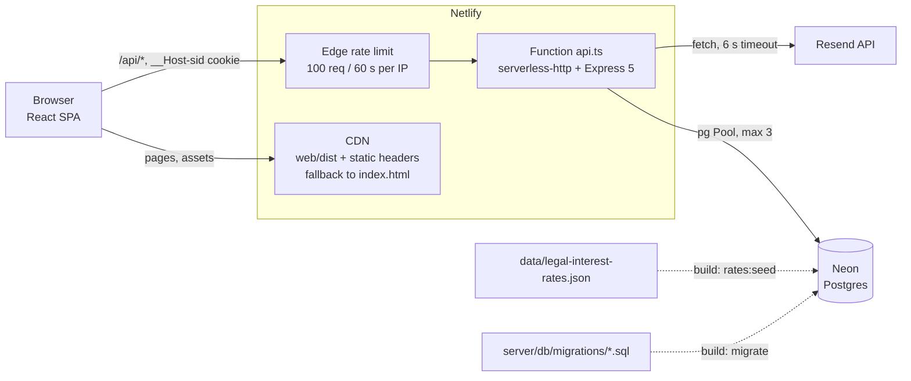
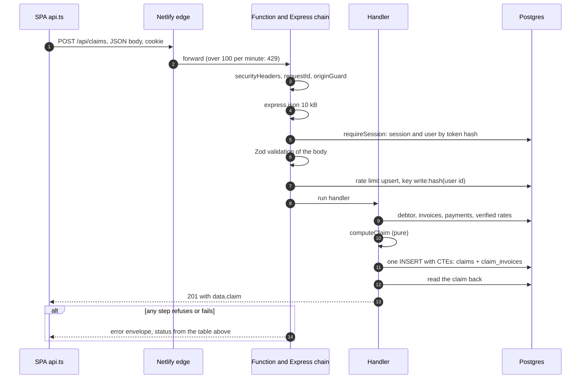
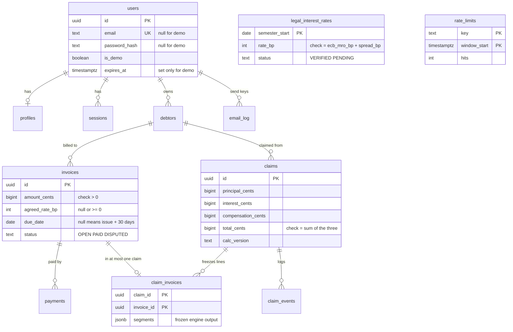

# Architecture

How Reclama is built and why. The [README](../README.md) has the product description, the worked interest example, the quickstart and the known limitations; this file goes deeper on structure, data, security and decisions. Every statement here was checked against the code or the SQL migrations. Where something could not be checked, it says so.

## 1. Overview

Reclama is a React single-page app and one Express 5 API. The SPA is static files on Netlify. Every `/api/*` request goes through Netlify's edge rate limit to one Netlify Function, which wraps the whole Express app and talks to a Neon Postgres database and, for the email feature, to the Resend HTTP API. The interest rates are not fetched at runtime: a JSON file in the repository is validated and written to the database during the build.



Environments, all running the same `createApp()` from [`server/app.ts`](../server/app.ts):

| Environment      | Database                     | Mailer                       | How it starts                        |
| ---------------- | ---------------------------- | ---------------------------- | ------------------------------------ |
| Netlify (deploy) | Neon, `DATABASE_URL`         | Resend if `RESEND_API_KEY`   | `npm run build`, Function `api.ts`   |
| Local, real DB   | Any Postgres, `DATABASE_URL` | Resend if `RESEND_API_KEY`   | `npm run dev` (listens on 127.0.0.1) |
| Local, in-memory | PGlite (WASM Postgres)       | Fake mailer, nothing is sent | `npm run dev:memory`                 |
| Tests            | PGlite, in memory            | Fake mailer                  | `npm test`                           |

The Vite dev server (`npm run web:dev`, port 5173) proxies `/api` to port 3000, so the browser sees one origin.

## 2. Repository layout

Test files sit next to the code they test (`*.test.ts`, `*.test.tsx`).

```text
.
├── data/                    legal-interest-rates.json (source of truth for rates), sample CSV
├── docs/                    LEGAL-SOURCES.md (Spanish), images/, design/ (static sketches and fonts)
├── netlify/functions/api.ts the only Netlify-specific file; also the edge rate-limit config
├── scripts/                 migrate.ts, rates-seed.ts, rates-verify.ts, screenshots.ts
├── server/
│   ├── app.ts               createApp(): middleware order and route registration
│   ├── config.ts            email settings from env; defaults to sandbox
│   ├── clock.ts             the only place that reads the real time
│   ├── netlify-adapter.ts   Express to Netlify handler; client IP; binary PDF
│   ├── dev.ts, dev-memory.ts  local servers
│   ├── auth/                password hashing, session tokens, the cookie
│   ├── db/                  repositories (all SQL), migration runner, migrations/
│   ├── domain/              PURE: no I/O, no clock, no imports from db/routes/http/middleware/services/auth
│   ├── http/                route registry (defineRoute), shared Zod pieces
│   ├── middleware/          security headers, request id, origin guard, session, errors
│   ├── routes/              one file per resource: registerXRoutes(defineRoute, deps)
│   └── services/            PDF letter (pdfkit), mailer (Resend over fetch), fake mailer
├── web/
│   ├── index.html, vite.config.ts, public/
│   └── src/                 routes.tsx, pages/, components/, lib/, content/, styles/, test/
├── .github/workflows/ci.yml lint, typecheck, build, format, test, rates, audit
└── .githooks/pre-commit     the same checks as CI, before every commit
```

Rules that govern the layers:

- `server/domain` imports nothing from the other server folders (checked with grep). ESLint also bans `Date.now()`, `new Date()` without arguments, `parseFloat`, `toFixed` and `Math.round` there and in `server/services`. The "no I/O" part is a convention, not a lint rule.
- Every repository function in `server/db` takes `userId` first and filters by it. Routes never build SQL.
- The web app never imports server code. The only crossings are in tests: `landing-example.test.ts` and `import-columns.test.ts` read two plain-data files from `web/src/content/`.

## 3. Request lifecycle

The order below is the real one. It comes from [`server/app.ts`](../server/app.ts) and [`server/http/routes.ts`](../server/http/routes.ts).

| #   | Step                                               | Refusal                                                         |
| --- | -------------------------------------------------- | --------------------------------------------------------------- |
| 1   | Netlify edge rate limit (100 per 60 s per IP)      | 429 from the edge, with no JSON body                            |
| 2   | Adapter: `req.ip` from `x-nf-client-connection-ip` | none                                                            |
| 3   | `securityHeaders`                                  | none (sets `no-store`, `nosniff`, `default-src 'none'`)         |
| 4   | `requestId` (always generated here)                | none                                                            |
| 5   | `originGuard`                                      | 403 `FORBIDDEN_ORIGIN`, 415 `UNSUPPORTED_MEDIA_TYPE`            |
| 6   | `express.json({ limit: '10kb' })`                  | 400 `INVALID_JSON`, 400 `INVALID_BODY`, 413 `PAYLOAD_TOO_LARGE` |
| 7   | `requireSession` (session routes only)             | 401 `UNAUTHENTICATED`                                           |
| 8   | Zod body and query validation                      | 400 `VALIDATION_ERROR` with `details`                           |
| 9   | Per-route rate-limit rules, in order               | 429 `RATE_LIMITED` with `Retry-After`                           |
| 10  | Handler, then repository                           | 404, 409, 422 business codes                                    |
| 11  | `notFoundHandler`, `errorHandler`                  | 404 `NOT_FOUND`, 500 `INTERNAL_ERROR`                           |

Two exceptions to the table:

- `POST /api/imports` carries a CSV of up to 1 MB as base64. It gets a bigger JSON parser, placed after `requireSession`, so an anonymous caller gets a 401 before the server buffers anything large.
- `POST /api/claims/:id/email` checks its own limits inside the handler, in a deliberate order (see section 5).

Steps 6 and 7 mean an unauthenticated request with malformed JSON gets a 400, not a 401. Validation (8) runs after the session check, so an anonymous caller learns nothing about request shapes. Rate limits (9) run after validation, so a malformed request does not use up a counter.

Authenticated write, `POST /api/claims`:



Every error uses one envelope, built by `sendError`:

```json
{
  "error": {
    "code": "VALIDATION_ERROR",
    "message": "Request validation failed",
    "request_id": "…",
    "details": [{ "path": "email", "message": "…" }]
  }
}
```

`details` is sent only for validation errors and for a few business errors (`limit`, `missing_semesters`). It describes the rule that failed, never the value sent. An unexpected exception becomes a fixed 500 `INTERNAL_ERROR`; the log line holds the request id and the error name only. A missing row, a malformed id and another user's row all give the same 404.

## 4. Data model



The diagram omits `user_id` on every user-owned table, the `debtors` and `payments` columns and the `profiles` columns. `legal_interest_rates` and `rate_limits` belong to no user. That makes 12 tables, as the README says, plus `schema_migrations`, which the migration runner creates.

Constraints that carry the rules (all from the migrations, and exercised by `server/db/schema.test.ts` as control/violation pairs):

| Rule                                              | Mechanism                                                                                                                          |
| ------------------------------------------------- | ---------------------------------------------------------------------------------------------------------------------------------- |
| Money is integer cents                            | `bigint` columns; checks `amount_cents > 0`, `interest_cents >= 0`, `total = principal + interest + compensation`                  |
| Rates are integer basis points                    | `rate_bp int`, `rate_bp = ecb_mro_bp + spread_bp`, semester starts on 1 Jan or 1 Jul                                               |
| A user's rows cannot point at another user's rows | Composite foreign keys `(user_id, parent_id)` to `unique (user_id, id)` on every child table                                       |
| Erasing a user erases everything                  | `user_id references users on delete cascade` on every user-owned table                                                             |
| One claim per invoice                             | Unique index `claim_invoices_one_claim_per_invoice (user_id, invoice_id)`                                                          |
| An invoice in a claim cannot be deleted           | `claim_invoices` to `invoices` foreign key with no `on delete` action (the API answers 409)                                        |
| Cancelling a claim frees its invoices             | `claim_invoices` and `claim_events` cascade from `claims`                                                                          |
| One invoice number per debtor                     | `unique (user_id, debtor_id, number)`                                                                                              |
| Payments never exceed the invoice                 | Trigger `payments_check_total` (locks the invoice row, re-reads payments); trigger `invoices_check_amount` for lowering the amount |
| Demo users look different from real users         | Checks tie `is_demo` to a null `password_hash` and a non-null `expires_at`; a real user must have an email                         |
| Sessions store no usable token                    | `token_hash bytea` holds a SHA-256 (32 bytes), never the token                                                                     |
| One send per idempotency key                      | `email_log` primary key `(user_id, idempotency_key)`                                                                               |

`email_log.created_at` is not read by any query (grep). The daily email caps are counters in `rate_limits`; a comment in migration 0001 says they are counted on `email_log.created_at`, which is out of date and cannot be edited (see below).

**Migrations.** Plain SQL files `NNNN_snake_case.sql`, applied by [`server/db/migrate.ts`](../server/db/migrate.ts):

- Forward-only: no down migrations.
- The SHA-256 of every applied file is stored in `schema_migrations`. If a file changed after it was applied, the run stops with `Migration … was modified after being applied` before touching the database. Applied migrations are therefore immutable; a fix is a new migration.
- Each migration runs in its own transaction, under `pg_advisory_xact_lock`, so two concurrent runners apply it once. The lock is transaction-scoped because a session-level lock can be released on another connection behind a transaction pooler.
- `npm run build` runs `npm run migrate` (a dedicated `pg.Client`, not the pool) and then `rates:seed`. Both exit early when `CONTEXT=deploy-preview`, because the database is shared by every build. Any other context, including a branch deploy, applies them.
- The same runner builds the PGlite database in tests and in `dev:memory`.

## 5. Core domain

### Interest engine

[`server/domain/interest.ts`](../server/domain/interest.ts), `calculateDefaultInterest`. Pure; time and rates come in as arguments.

- **Input:** principal (cents), issue date, due date or `null`, `asOf`, payments, agreed rate (basis points) or `null`, and the rate table.
- **Output:** total interest, `segments[]`, `warnings`, the due date used and whether it was estimated. All plain numbers and strings, because a claim stores it as JSON.
- **Due date:** when `null`, issue date + 30 days. A given due date more than 60 days after issue adds the warning `TERM_OVER_60_DAYS`.
- **Accrual:** starts the day after the due date. If `asOf` is on or before the due date, the result is zero and the rate table is never read.
- **Segments:** one per semester, also ends on the day of a late payment, and the next one starts the day after. A payment on or before the due date lowers the balance before accrual; a later payment still accrues on the old balance for its own day. Payments dated after `asOf` are ignored.
- **Arithmetic:** `BigInt` throughout. For one segment: `floor((2·P·bp·D + 10000·Y) / (20000·Y))`, which is `P·bp·D / (10000·Y)` rounded half up to the cent. The total is the sum of the rounded segments. `Y` is 365 or 366 for the year of the segment (actual/actual). Results above `Number.MAX_SAFE_INTEGER` throw `RangeError`.
- **Rates:** an agreed rate replaces the table. Otherwise each segment looks up the verified row that covers its first day. Missing semesters are collected, then `RateWindowError` is thrown; the API answers 422 `RATE_WINDOW` with `missing_semesters`. The engine never extrapolates.

**Rate table.** `data/legal-interest-rates.json` is the source of truth. `parseRates` checks the shape (integers, valid dates). `verifyRates` checks the rules: the semester starts on 1 Jan or 1 Jul and ends on the right day, `spread_bp` is 800, `rate_bp = ecb_mro_bp + spread_bp`, no duplicate semesters or BOE references, a `VERIFIED` row has a BOE reference and a publication date, and the semesters are contiguous. `npm run rates:verify` runs this offline in CI; `rates:seed` runs it again before an idempotent upsert in one transaction. At runtime only `VERIFIED` rows are read; a `PENDING` row counts as absent.

`rates:verify` proves the table is internally consistent. It does not prove that the values match the BOE. That was checked by hand and is recorded in [`docs/LEGAL-SOURCES.md`](LEGAL-SOURCES.md) (in Spanish), which also lists what was not verified.

**How it is tested.** `interest.reference.ts` is a second implementation that shares no logic with the engine: it walks day by day, uses its own calendar maths and exact fractions, and only then groups days and rounds. `interest.test.ts` runs worked examples through both and also 5,000 seeded pseudo-random cases (a failure can be reproduced from the seed). `landing-example.test.ts` recomputes the home-page example from the real rates.

### Claims

[`server/domain/claim.ts`](../server/domain/claim.ts) `computeClaim` sums the lines and adds the compensation: 4,000 cents once (`PER_CLAIM`), once per overdue invoice (`PER_INVOICE`), or zero (`NONE`). It refuses consumers and public administrations (`DEBTOR_NOT_B2B`) and a claim with no overdue invoice (`NOT_OVERDUE`). `POST /api/claims` also refuses a debtor whose kind is `UNKNOWN`.

- **Frozen.** The client sends a debtor id and optional invoice ids, an `as_of` date and a compensation mode. Zod drops every other key. The handler loads invoices and payments, calls `computeClaim`, and `createClaim` writes the `claims` row and its `claim_invoices` lines in one statement (CTEs), or nothing. `calc_version` (`interest-v1`) is stored with the claim.
- **Locked invoices.** Updating or deleting an invoice that is in a claim fails with `INVOICE_IN_CLAIM`. Its status can change, and payments can still be recorded.
- **Staleness.** A payment after the claim was created makes the frozen principal wrong. `notActionableReason` ([`server/routes/letter.ts`](../server/routes/letter.ts)) compares each frozen principal with `amount - payments` today. It also refuses when the debtor is no longer a business, the claim has a `PAID` event, or an invoice is `PAID`. The reasons are `debtor_not_business`, `marked_paid`, `invoice_paid` and `invoice_changed`. Both the PDF and the email return 422 `CLAIM_NOT_ACTIONABLE` with the reason. The check does not recalculate interest; interest is frozen by design.
- **Cancel.** `DELETE /api/claims/:id` is allowed even after steps were recorded, and frees the invoices. The only way to a fresh claim for a stale one is to cancel it.
- **Caps:** 500 claims per account, 100 invoices per claim, 200 events per claim.

### Escalation

[`server/domain/escalation.ts`](../server/domain/escalation.ts) `nextAction` is pure: it receives `today`, the frozen lines, the events and the debtor kind. It is computed on every read; nothing about it is stored.

- The most advanced recorded step decides (reminder, demand, burofax, monitorio). Steps may be skipped. A `PAID` event gives `DONE`; a debtor that is not a business gives `BLOCKED`.
- `earliest_on` is the last step's date plus a wait: 7, 10 and 10 days. These are the app's own heuristics, not legal deadlines, and every `reason` says so. The waits are a parameter of the function; no API option changes them.
- `POSSIBLE_LIMITATION` warns when the oldest due date is more than 54 months old (the general five-year period of art. 1964 of the Código Civil, with margin). The list endpoint passes no lines, so it never shows this warning; the detail endpoint does.
- `GET /api/claims/:id` returns the action with its guide from `ESCALATION_GUIDE` in `escalation-guide.ts`: steps, what to prepare, notes and a letter template with `{{placeholders}}`. The text is static Spanish and carries no amounts. Each legal statement is meant to have a source in `docs/LEGAL-SOURCES.md`; burofax advice is recorded there as common practice, not verified. The browser fills the placeholders (`web/src/lib/claims.ts`); `renderTemplate` in the server module has no production caller (grep).

### PDF letter and email

[`server/services/letter.ts`](../server/services/letter.ts) `renderLetter` draws the letter with pdfkit and the built-in Helvetica font. It prints the frozen figures and never recalculates. Limits: 1,500 interest segments, six address lines and 40 pages. The creation date is the letter date, so the same data gives the same file.

Helvetica draws only Windows-1252, so every user-typed string passes through `sanitizeForPdf` ([`server/domain/pdf-text.ts`](../server/domain/pdf-text.ts)): Unicode NFC, control and invisible characters dropped (zero width, right-to-left overrides), look-alikes mapped, anything else replaced by `?`. The profile check applies the same function, so a name made only of invisible characters counts as missing. The download filename is built from the claim (ASCII slug), never from raw text.

`POST /api/claims/:id/email` follows a fixed order, documented in the handler: header, claim exists, mailer configured (503 `EMAIL_NOT_CONFIGURED`), debtor has an email, profile complete, claim actionable, **claim the key**, count limits, render and send.

- **Modes.** `EMAIL_MODE` is `sandbox` unless exactly `live`. In sandbox, and always for demo users, the message goes to `EMAIL_TEST_RECIPIENT` with a `[PRUEBA]` subject, and no `DEMAND_SENT` event is recorded, so the escalation guide does not advance on a test. In live mode the event is recorded after the send. The recipient is never taken from the request.
- **Idempotency.** The client must send an `Idempotency-Key` (8 to 128 characters of letters, digits, `_`, `-`). The key stored in `email_log` and sent to Resend is `<claim id>:<client key>`. The insert is the claim on the key, so a replay gets 409 `EMAIL_ALREADY_SENT` and uses no quota. The browser keeps the key in `sessionStorage` so a reload repeats it.
- **Quota.** 3 per user and 20 for the whole service per UTC day, counted in `rate_limits` after the key is claimed. If a limit refuses, or the letter or the provider fails, the key is released and the counted hits are refunded.
- **Unknown outcome.** If the provider call times out (6 s) or fails on its side (`PROVIDER_UNAVAILABLE`), the email may have been accepted. The key is released so the client can retry with the same key, and Resend's own idempotency should stop a second delivery, but the hits stay used. That last behaviour depends on Resend honouring the key; it is not tested against the real service.
- **Errors.** The provider's text is dropped. The mailer maps it to four codes, and the API answers 502 `EMAIL_PROVIDER_ERROR` with a fixed reason. Neither the recipient nor the key reaches a log.

### CSV import

[`server/domain/csv-import.ts`](../server/domain/csv-import.ts) `parseInvoiceCsv` is the only CSV parser. The browser reads the file as bytes, base64-encodes it and sends it to `POST /api/imports`. The server detects the encoding (UTF-8 or Windows-1252) and delimiter, parses Spanish amounts and dates, and reports row-level errors and warnings. `papaparse` handles only quotes and line breaks.

- **Dry run, then commit.** The same endpoint takes `dry_run` (body or query). A dry run runs the same parser and the same limit check and returns counts and a 20-row preview without writing. The SPA sends the file again for the real import.
- **Limits:** 1 MiB, 500 rows, 200 characters per text cell, 2,000 invoices per account, 20 imports per hour per user.
- **Writes:** two set-based statements (debtors, then invoices), both `on conflict do nothing`. If the second fails, debtors may exist without invoices; running the import again completes it.
- **Formula prefix.** A cell starting with `=`, `+`, `-` or `@` is kept as text and reported as a `FORMULA_PREFIX` warning. There is no CSV or spreadsheet export in the app, so nothing re-emits it today.

## 6. Frontend

React 19, React Router, Vite, plain CSS. All code is in `web/src`.

- **Routing** ([`routes.tsx`](../web/src/routes.tsx)). One layout route wraps everything in `SessionProvider`. `RequireAuth` guards the private pages; `RedirectIfAuth` keeps signed-in users away from login and registration (a demo user may stay). The page asked for is kept in router state, not in the URL, so it is not logged or sent in `Referer`. The routes are in Spanish (`/panel`, `/reclamaciones`); unknown paths show `NotFound`.
- **Session** ([`lib/session.tsx`](../web/src/lib/session.tsx)). The cookie is `HttpOnly`, so JavaScript cannot read it. The state comes only from `GET /api/me`: `loading`, `anonymous`, `unavailable` (network or 5xx: we do not know), `authenticated`. A hiccup never turns a signed-in user into an anonymous one. Out-of-order answers are dropped. Any call that gets 401 `UNAUTHENTICATED` flips the app to anonymous through `onSessionExpired`.
- **API client** ([`lib/api.ts`](../web/src/lib/api.ts)). `api()` and `apiFile()` never throw. They return `ApiResult<T>`: `{ ok: true, data }` or a `Failure` with a `kind` (`validation`, `unauthenticated`, `forbidden`, `not_found`, `conflict`, `rate_limited`, `unavailable`, `network`, `server`), the HTTP status, the server's `code`, `details`, `extra` and `retryAfter`. Non-JSON answers (an empty edge 429, an HTML 502) become failures; a 2xx without the `data` envelope is a `server` failure. `apiFile` checks the content type before treating the body as a file, and accepts a filename from `Content-Disposition` only if it is a plain name.
- **Data loading.** `useLoad(key, load)` runs when the key changes, drops stale answers, and keeps the previous result visible during a reload.
- **Forms and accessibility.** `Field` components wire `label`, `aria-describedby` and `aria-invalid`. `useBusy` locks double submits; `useFocusOnErrors` moves focus to the first error. After a route change, focus moves to `<main>`; there is a skip link and a `:focus-visible` outline. `eslint-plugin-jsx-a11y` runs in lint. There is no automated accessibility audit beyond that, and no assistive-technology testing is documented.
- **Styling.** Plain CSS with tokens in `tokens.css`; light and dark follow the system through `light-dark()`. Fonts are `@fontsource` packages bundled by Vite (`assetsInlineLimit: 0` keeps them as files, because a `data:` URI would be blocked by the CSP). No inline `<style>` or `style="..."` markup. Data-dependent values go through React's `style` prop, which sets them through the CSSOM; a strict `style-src` allows that.
- **Language.** The interface is Spanish only. The server sends codes, paths and English rule descriptions for developers; `lib/messages.ts` turns them into Spanish text.
- **Mirrored server rules.** Response types (`api-types.ts`) are written by hand. A few server constants are copied for instant feedback: the email pattern, the CSV size limit, the payment deadline in days, the invoices-per-claim cap. The server stays the authority. There is no shared package or code generation.

## 7. Security model

**Trust boundaries.** The browser is untrusted, including its cookies and headers. The Function trusts the database and the build-time files. Resend is reached over HTTPS with the key in an `Authorization` header only. The connection string must contain `sslmode=require` for TLS; that is a deployment setting I could not verify from the repository.

**Authentication.**

- Passwords: argon2id from `node:crypto` (19,456 KiB, 2 passes, 1 lane, 32-byte tag, 16-byte salt), after Unicode NFKC normalisation; 10 to 128 characters counted in code points. Hashes made with weaker parameters are upgraded at the next successful login (`needsRehash`). An unknown email still costs one argon2id computation (`verifyAgainstDummy`), so timing does not reveal which emails exist.
- Sessions: 32 random bytes, base64url. Only the SHA-256 is stored. The cookie is `__Host-sid`, `HttpOnly`, `Secure`, `SameSite=Lax`, `Path=/`, no `Domain`. Lifetime is absolute, 7 days, with no sliding renewal. A demo session lasts 2 hours and its user expires after 24. Logout deletes that one row. Expired sessions are removed at login. A new token is created at every login.
- Every session failure (no cookie, garbage, unknown, expired) gives the same 401.

**Authorization.** Ownership is enforced three times: the session gives `userId`; every repository query filters by `user_id`; composite foreign keys make the database refuse cross-user references. Foreign and missing ids both give 404. Two tests pin this:

- [`route-registry.test.ts`](../server/http/route-registry.test.ts) lists the six public routes (`GET /api/health`, `/api/health/ready`, `/api/rates`; `POST /api/auth/login`, `/api/auth/register`, `/api/demo/session`). A new public route fails the test until it is added on purpose. Every other route must answer 401 without a cookie.
- [`data-isolation.test.ts`](../server/routes/data-isolation.test.ts) is the IDOR matrix. It builds user A's data, then calls every registered route that has a path parameter, with every method, as user B (a regular user and a demo user), and expects 404 and no change to A's data. A new route with a `:param` fails until a request is added.

The matrix covers path parameters. Foreign ids in a body (a debtor or invoice id in `POST /api/claims`) are covered by tests in `claims.test.ts`.

**Input validation.** Zod at the boundary for bodies and queries; unlisted keys are dropped, so a client cannot set `user_id` or a status. Path ids go through `idParam` (UUID or 404). The cookie and `Idempotency-Key` are parsed with strict patterns. Dates are limited to 1990 to 2099, amounts to 1,000,000,000.00 EUR, page size to 100. Text fields reject control characters, which would make Postgres fail on NUL.

**CSRF.** No CORS headers anywhere. `originGuard` on POST, PATCH, PUT and DELETE: if `Sec-Fetch-Site` is present, it must be `same-origin` or `none`; otherwise `Origin` must equal `Host` exactly (`X-Forwarded-Host` is ignored); a request with neither is allowed because it is not a browser. A body must be `application/json` (UTF-8). The cookie is `SameSite=Lax`. State changes never use GET.

**Rate limiting.** Two layers. The edge allows 100 requests per 60 seconds per IP (`config.rateLimit` in `api.ts`). Inside the app, fixed-window counters live in `rate_limits`, incremented with one atomic upsert. A database error fails closed (500). Rules, checked in order, and the first refusal answers 429 without counting the others:

| Rule             | Key                                                                                   | Limit          |
| ---------------- | ------------------------------------------------------------------------------------- | -------------- |
| `register`       | IP                                                                                    | 5 per hour     |
| `login-ip`       | IP                                                                                    | 30 per 15 min  |
| `login`          | IP + hash(email)                                                                      | 5 per 15 min   |
| `login-account`  | hash(email)                                                                           | 20 per 15 min  |
| `demo-session`   | IP                                                                                    | 10 per hour    |
| `delete-account` | hash(user id)                                                                         | 5 per 15 min   |
| `import`         | hash(user id)                                                                         | 20 per hour    |
| `write`          | hash(user id), shared by all writes to debtors, invoices, payments, claims and events | 120 per hour   |
| `letter-pdf`     | hash(user id)                                                                         | 60 per hour    |
| `email-user`     | hash(user id)                                                                         | 3 per UTC day  |
| `email-global`   | fixed key                                                                             | 20 per UTC day |

An IPv6 address is reduced to its /64 and an IPv4-mapped address counts as IPv4. IPs are stored unhashed in the keys (emails and user ids are hashed). Old windows are deleted when a request opens a new counter, after 2 days; with no traffic nothing is deleted. `login-account` lets someone who knows an email lock that account for up to 15 minutes; the code comment accepts this.

**Headers.** API answers get `Cache-Control: no-store`, `X-Content-Type-Options: nosniff` and `Content-Security-Policy: default-src 'none'` from `securityHeaders`; `x-powered-by` and ETags are off. The static site gets, from `netlify.toml`, a CSP of `'self'` only (no inline scripts or styles, no third-party hosts), HSTS (1 year, `includeSubDomains`), `X-Frame-Options: DENY`, `Referrer-Policy`, `Permissions-Policy`, and COOP and CORP `same-origin`. The code comment says `netlify.toml` headers are not applied to Functions, so the API relies on its own three.

**Demo sandbox.** `POST /api/demo/session` is public. Controls: 10 per hour per IP; at most 200 unexpired demo users (503 `DEMO_FULL`); each creation first purges up to 100 expired ones; the user has no password and cannot be deleted (403); the sandbox is created by one statement, with fictitious data (reserved `example.com` addresses, tax ids that cannot exist); email always goes to the sandbox recipient. Demo users have the same per-account caps as real ones.

**Email abuse.** Sandbox by default and for every demo user; the recipient is the stored debtor email, never a request value; caps of 3 per user and 20 global per day; required idempotency key; plain text plus the PDF; B2B debtors only. In live mode any registered user (there is no email verification) could send to any address they store as a debtor. The daily caps are the only brake. This is why live mode is off.

**Secrets.** Variable names only: `DATABASE_URL`, `RESEND_API_KEY`, `EMAIL_FROM`, `EMAIL_MODE`, `EMAIL_TEST_RECIPIENT`, `PORT` (local server). `CONTEXT` is set by Netlify and read by the scripts. Values live in the Netlify UI or a local `.env`; [`.env.example`](../.env.example) has empty placeholders. The API key travels only in the Resend `Authorization` header. Without `RESEND_API_KEY` the app starts and the email route answers 503.

**Logging.** There is no request logger. The only log lines are JSON with `level`, `request_id` and `error_name` (plus a fixed `reason` for mail failures). Messages, stacks, bodies, recipients, keys and connection errors are not logged.

**Not covered.** No two-factor login, email verification, password change or recovery, and no way to end other sessions. `PATCH /api/me/profile` and `POST /api/auth/logout` have no per-route limit; only the edge limit applies. No CAPTCHA. No audit log. Profile data, debtor names, tax ids, emails and the IBAN are stored as plain columns; encryption at rest is whatever Neon provides (not verified). `npm audit` is warning-only and there is no secret scanner in CI. The security reviews were assisted by AI tooling; no human penetration test was done.

## 8. Testing and CI

| Layer                 | What it runs against                                                                                                             | Examples                                                       |
| --------------------- | -------------------------------------------------------------------------------------------------------------------------------- | -------------------------------------------------------------- |
| Pure domain           | Nothing: plain functions                                                                                                         | interest, claim, escalation, money, dates, csv-import          |
| Repositories and SQL  | PGlite with every migration applied by the real runner                                                                           | `schema.test.ts`, `payments.test.ts`, `migrate.pglite.test.ts` |
| Routes and middleware | The real Express app on a real HTTP port, PGlite, a fake mailer, an injected clock                                               | `routes/*.test.ts`, `origin-guard.test.ts`                     |
| Web                   | jsdom and Testing Library; a scripted `fetch` (`web/src/test/mock-api.ts`) where an unscripted request fails like a dead network | `pages/*.test.tsx`, `lib/api.test.ts`                          |

The suite is 79 test files run by one Vitest command. The clock is injected (`Clock`), so tests move time. Tests that encode architecture rules: the route registry, the IDOR matrix, the schema constraint pairs, migration checksum and immutability, the origin guard, security headers, error shapes, the interest reference cross-check, the home-page example recomputation, and `import-columns.test.ts` (the web's column list against the parser). ESLint adds the clock and float bans in the domain and services, `strictTypeChecked`, hooks and a11y rules in `web/`.

`.github/workflows/ci.yml` runs on every push and pull request on Ubuntu with the Node version from `.nvmrc`: `npm ci`, lint, typecheck (server and web), web build, Prettier check, tests, `rates:verify`, an end-to-end run of the demo flow (`scripts/e2e.ts`: the real browser against the in-memory API and the Vite dev server) and `npm audit --omit=dev` (allowed to fail). `.githooks/pre-commit` runs the same checks before each commit (it retries the tests once because of a Windows-only worker crash noted in the hook).

Not tested:

- **Concurrency.** PGlite has one connection, so races cannot be reproduced. For the payment trigger, `payments.test.ts` simulates the statement that loses the race. I did not find the same for the one-claim-per-invoice index or the email key.
- Real Neon, Resend and Netlify behaviour. The Resend client is tested with a scripted `fetch`.
- Beyond the one demo-flow browser test: visual regression, load or performance, other browsers, and assistive-technology use.
- The deploy-time checks recorded in `netlify.toml` (the pdfkit bundle, `/api/*` taking precedence over the SPA fallback) were verified only locally in those comments. I could not tell from the repository whether they were confirmed on a deploy.

## 9. Deployment and operations

- **Build.** [`netlify.toml`](../netlify.toml) runs `npm run build`: typecheck, `migrate`, `rates:seed`, `web:build`. It publishes `web/dist`. A failed type check stops the build before the database is touched; a failure after `migrate` leaves the database ahead of the deployed code.
- **Function.** `netlify/functions/api.ts` answers `/api/*`. The `[[redirects]]` rule sends other paths to `index.html` (status 200) for the SPA.
- **pdfkit is external.** `external_node_modules = ["pdfkit"]`: bundled into esbuild's output, pdfkit cannot find its font data and the PDF endpoint would answer 500.
- **Binary bodies.** The adapter lists `application/pdf` as binary; any other non-text response type would need adding there.
- **Client IP.** `req.ip` comes from the `x-nf-client-connection-ip` header through the adapter. `X-Forwarded-For` is never used.
- **Database.** One pool per warm instance, `max: 3`, 5 s connect and statement timeouts, 10 s idle timeout. Neon's free tier suspends idle compute, so the first request after a pause can be slow (stated in the README, not measured here).
- **Function time.** The mailer gives up after 6 s because the comment assumes Netlify's default 10 s Function limit.
- **Environment variables.** The five names listed in section 7, set in the Netlify UI.
- **A release.** A push to `main` triggers a Netlify build on the branch deploy that serves the demo. Migrations and the rate seed run in that build, then the site and Function are published. There is no staged rollout. Migrations cannot be undone, so a destructive one has no way back. Nothing in the repository requires a migration to work with the previous Function version.
- **Health.** `GET /api/health` never touches the database. `GET /api/health/ready` checks that `schema_migrations` has a row and answers 503 `NOT_READY` otherwise.
- **Rates.** A new semester means a new row in the JSON file, a commit, and a build. After 2026-12-31 there is no verified row and calculations that reach 2027 fail with `RATE_WINDOW`. The demo answers 503 `DEMO_UNAVAILABLE` when the rates do not cover its dates.

## 10. Known limitations and trade-offs

The README lists the user-facing ones. Those that matter for the design:

- **Caps are not atomic.** The demo cap (200 active sandboxes) and the per-account caps (2,000 invoices, 500 claims, 100 invoices per claim, 200 events per claim, 200 payments per invoice) are a count followed by a write. Concurrent requests can pass together and overshoot slightly. The per-user write limit and the per-IP demo limit keep it small.
- **No transactions in `Db`.** The interface exposes `query` only. Atomic work is written as one statement with CTEs (user plus profile, demo seed, claim plus lines, payment plus invoice status). Where more than one statement is needed, the failure mode is documented: CSV import (debtors without invoices), `PATCH /api/invoices/:id` (a check then a write, backstopped by the trigger for the amount; a date change that slips through shows up as `CALCULATION_FAILED`), and the demo session (compensated by deleting the user).
- **Client IPs are stored unhashed** in rate-limit keys, kept up to 2 days, and only cleaned up when new windows open.
- **No email verification, password recovery or password change.** Live email is off for this reason.
- **Partial payments have no idempotency key.** A retried `POST /api/invoices/:id/payments` records a second payment. The trigger prevents overpaying the invoice, and the client locks double submits, but a network retry can duplicate a payment that is smaller than the balance.
- **Rates expire on 2027-01-01** and are added by hand.
- **No production deploy.** The demo is a branch deploy. The database is shared by every build; deploy previews skip migrations and the seed for that reason.
- **Interest is simple interest per semester**, one rounding per segment, as in the README. Other readings of the law (compound interest, rounding only on the total) are not offered.
- **B2B only; Spanish UI only.**
- **Duplicated client rules** (section 6) can drift from the server. The email pattern and the CSV limits are checked by tests in places; I did not verify every copy.
- **Single Function for the whole API.** One bundle and one pool per instance. I have not measured cold start or bundle size.

## 11. Architecture decision records

Each record states the context as the code and its comments describe it, the decision, and what it costs. "Alternative" is a path this code does not take.

### ADR-1: Integer cents everywhere, BigInt in the interest engine

- **Status:** Accepted.
- **Context:** The product's output is money that goes into a legal letter. `domain/money.ts`, the schema and the ESLint rules all state that amounts must be exact.
- **Decision:** Money is `bigint` cents in the database, a branded `Cents` number in code, and `BigInt` inside the interest engine. Rates are integer basis points. Amounts are parsed from text by hand (`parseMoney`), never with `parseFloat`; ESLint bans `parseFloat`, `toFixed` and `Math.round` in the domain and services. Values from `int8` columns that do not fit a safe integer throw instead of rounding.
- **Alternatives not chosen:** floating-point euros; a decimal library.
- **Cost:** Hand-written parsing and formatting (`formatEUR`) instead of `Intl`; `BigInt` to `number` conversions are checked at the edges; the cap is about 90 trillion euros in cents, far above the 1,000,000,000.00 EUR input limit.

### ADR-2: The server freezes the claim

- **Status:** Accepted.
- **Context:** The letter, the email and the screen must show the same figures, and a claim may be sent weeks after it was made.
- **Decision:** The client sends a debtor and a choice of invoices, never numbers. The server calculates and stores the totals and one `claim_invoices` row per invoice with the engine's segments as JSON. The PDF and the email read these rows. `calc_version` records the rule set.
- **Alternatives not chosen:** recomputing on every view; trusting figures sent by the client.
- **Cost:** A claim can go stale. It is handled by refusing to issue a letter (`notActionableReason`) and by letting the user cancel and recreate. Storing segments as JSON repeats data derivable from the invoice. A rule change creates a new `calc_version`, and old claims keep old figures by design.

### ADR-3: One CSV parser, on the server

- **Status:** Accepted.
- **Context:** Spanish Excel files vary in encoding (UTF-8 or Windows-1252), delimiter, amount format (`1.234,56`) and date format. Two parsers would disagree.
- **Decision:** The browser sends raw bytes as base64 and shows the server's report. The same code path serves the dry run and the commit. Row issues have codes; the client maps them to text.
- **Alternatives not chosen:** parsing in the browser and sending JSON rows; a separate upload endpoint.
- **Cost:** A 1 MiB file becomes about 1.4 MB of JSON, which needs a second, larger body parser on one path. The file is uploaded twice (dry run, then commit). Every column change touches `web/src/content/import-columns.ts` and its test.

### ADR-4: A pure domain layer

- **Status:** Accepted.
- **Context:** The rules that decide what a person is told they are owed are the part most worth testing and the part that must not depend on the network or the date.
- **Decision:** `server/domain` has no I/O and no clock; callers pass `today`, rates and payments. `server/clock.ts` is the only reader of real time, and routes pass a `Clock`. ESLint enforces the clock and float bans in the domain and services.
- **Alternatives not chosen:** domain code that reads the database or `new Date()`; classes with injected repositories.
- **Cost:** Routes do the loading and pass plain data in, so handlers such as `POST /api/claims` are long. The "no imports from I/O layers" rule is a convention that tests and review keep, not a lint rule.

### ADR-5: One Express app as one Netlify Function

- **Status:** Accepted.
- **Context:** `api.ts` calls itself the only Netlify-specific file. Tests and `dev:memory` run the same app.
- **Decision:** `serverless-http` and `@netlify/aws-lambda-compat` wrap `createApp()`; the Function declares `path: '/api/*'`. Security headers, error shape and rate limits are set in code, because `netlify.toml` headers are not applied to Functions.
- **Alternatives not chosen:** one Function per route; a framework-specific serverless runtime.
- **Cost:** Every route shares one bundle, one cold start and one pool (`max: 3` per instance). Route-level scaling and timeouts are not independent. A thin adapter has to translate details: the client IP header, empty-body statuses, and binary PDF responses. The same app also runs standalone (`server/dev.ts`) with no Netlify code.

### ADR-6: Postgres on Neon, plain SQL migrations, no ORM

- **Status:** Accepted.
- **Context:** The invariants (cents checks, one claim per invoice, no overpayment, no cross-user references) have to hold even if application code forgets a `where user_id`.
- **Decision:** `pg` with hand-written SQL in repositories. Forward-only migration files with checksums. Invariants live in the schema: checks, composite foreign keys, a unique index, two triggers. The `Db` interface has no transaction API, so atomic writes are single statements.
- **Alternatives not chosen:** an ORM or query builder; application-level transactions; checking ownership only in code.
- **Cost:** More SQL to write and review; row types are cast by hand (`as Claim[]`) with no generated types. No down migrations. Operations that need several statements are not atomic (section 10). Neon's pooled connection is used by design (the migration lock is transaction-scoped for that reason).

### ADR-7: Server-side sessions in a `__Host-` cookie, argon2id from `node:crypto`

- **Status:** Accepted.
- **Context:** The session cookie must not be readable by scripts, and a leaked database must not give logins. The password hash must be strong without adding a dependency.
- **Decision:** An opaque 256-bit token in an `HttpOnly`, `Secure`, `SameSite=Lax` cookie with the `__Host-` prefix. The database stores its SHA-256. Each request looks the session up. Passwords use argon2id with the OWASP minimum parameters, from `node:crypto`, which runs on the thread pool.
- **Alternatives not chosen:** a JWT kept in browser storage; a signed cookie with no server state; an argon2 or bcrypt npm package.
- **Cost:** One database read per authenticated request. Sessions can be revoked (logout deletes the row), but there is no "end all sessions" action. `crypto.argon2` needs a Node release that ships it; `engines` requires Node 24 or newer (the exact minimum minor version is not verified). The `Secure` cookie means local use over plain HTTP needs a browser that treats `localhost` as secure; the README notes this.

### ADR-8: Email is sandboxed by default

- **Status:** Accepted.
- **Context:** `config.ts` explains it: without a verified sending domain Resend delivers only to the account owner, and an endpoint that sends a letter to any address its caller types would be a spam vector. Anyone can open a demo with no email check.
- **Decision:** `EMAIL_MODE` defaults to `sandbox` and anything other than exactly `live` stays there. Demo users are always in sandbox. A sandbox send goes to the test recipient, is marked `[PRUEBA]` and records no escalation event. The provider is called through `fetch` with an idempotency key, a 6 s timeout and error text dropped.
- **Alternatives not chosen:** sending to the debtor from the first release; a Resend SDK.
- **Cost:** The product does not reach real debtors until a domain is verified. The sandbox path and the live path share the code, but neither has been exercised against the real service yet: no Resend API key is configured on the deployment.

### ADR-9: PGlite for tests and the dev server

- **Status:** Accepted.
- **Context:** The correctness rules live in SQL (constraints, triggers, CTE statements). A fake database would not test them.
- **Decision:** Tests start an in-memory Postgres (PGlite) and apply every migration with the production runner and the production type parsers. `dev:memory` does the same, so the app runs with no account or setup.
- **Alternatives not chosen:** mocking the `Db` interface; a Docker Postgres in CI.
- **Cost:** PGlite is a different build of Postgres than Neon and has one connection, so concurrency cannot be tested (section 8). Each test file pays a start-up cost; Vitest is capped at 8 workers with long timeouts for slow runners.

### ADR-10: No third-party requests, strict CSP

- **Status:** Accepted.
- **Context:** The app handles invoices and debtor data. `netlify.toml` states the rule: no inline scripts or styles anywhere.
- **Decision:** `default-src 'self'` with `script-src`, `style-src`, `font-src`, `img-src` and `connect-src` all `'self'`. Fonts come from `@fontsource` packages and are served as files. The timeline is drawn with HTML, CSS and SVG; dynamic values use CSSOM through React. The API answers with `default-src 'none'`.
- **Alternatives not chosen:** Google Fonts or a CDN; `'unsafe-inline'` styles; inline `data:` fonts.
- **Cost:** Styles are written as classes in CSS files; data-driven layout is limited to CSS custom properties. Any new third-party resource needs a CSP change on purpose. Fonts are bundled, adding weight to the build.
